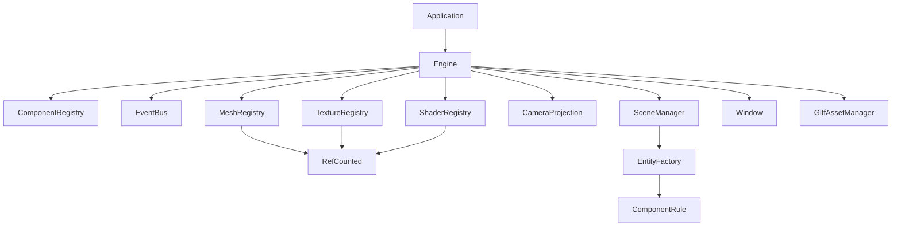
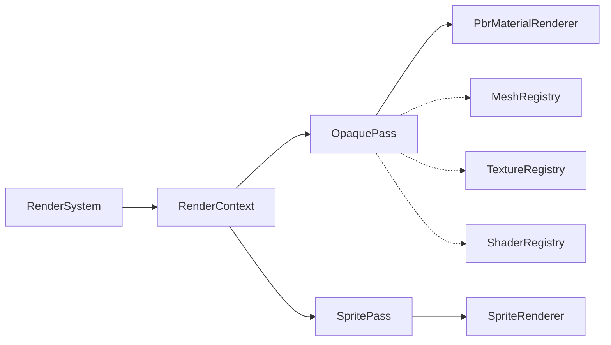
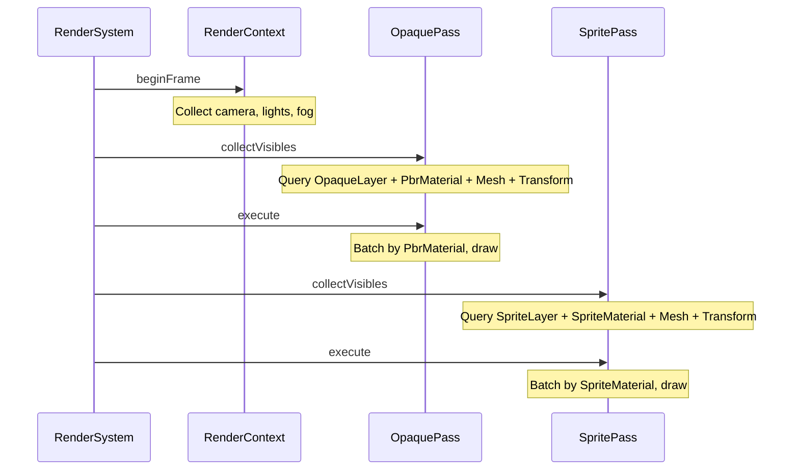
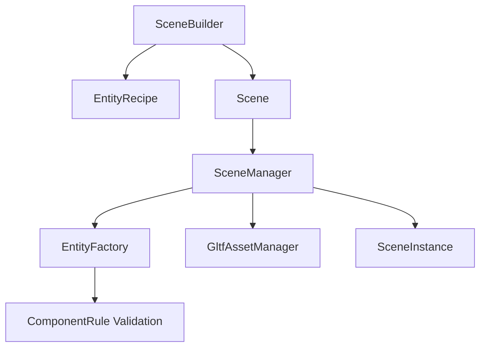
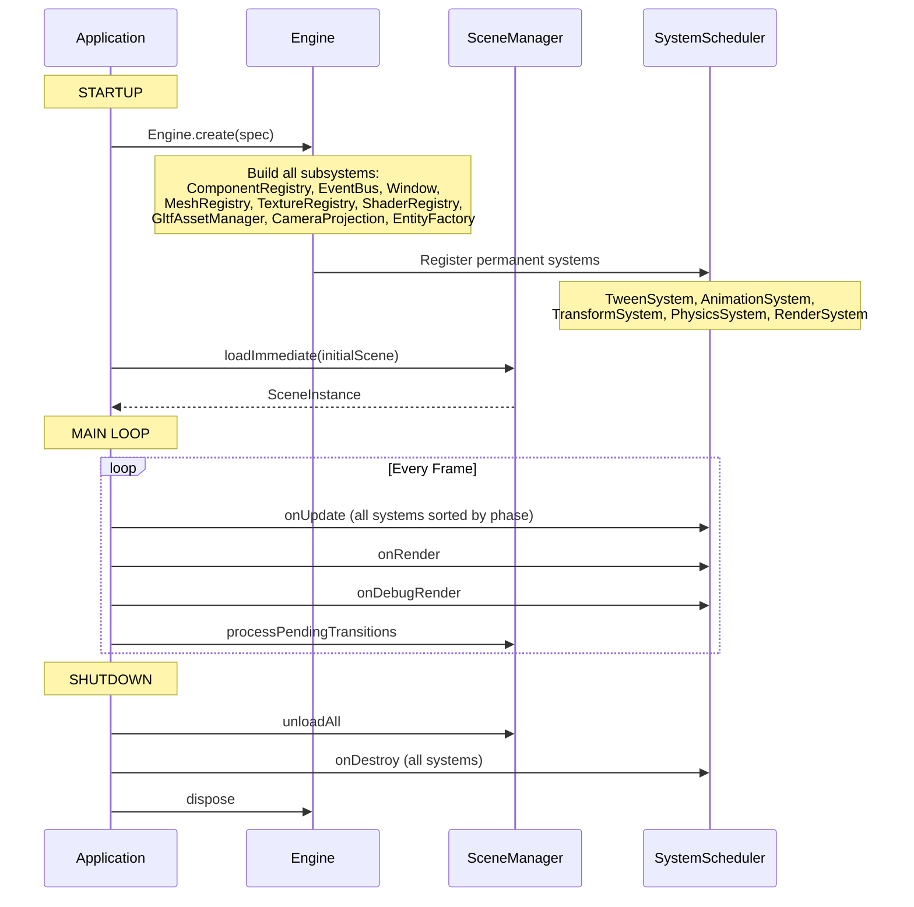
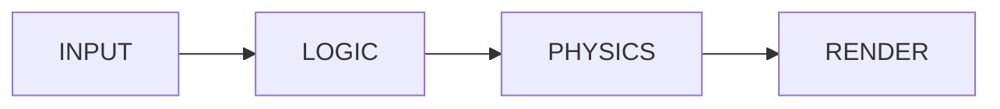
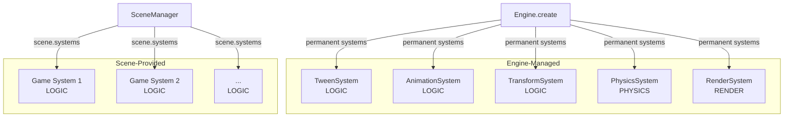
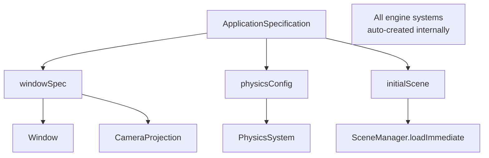
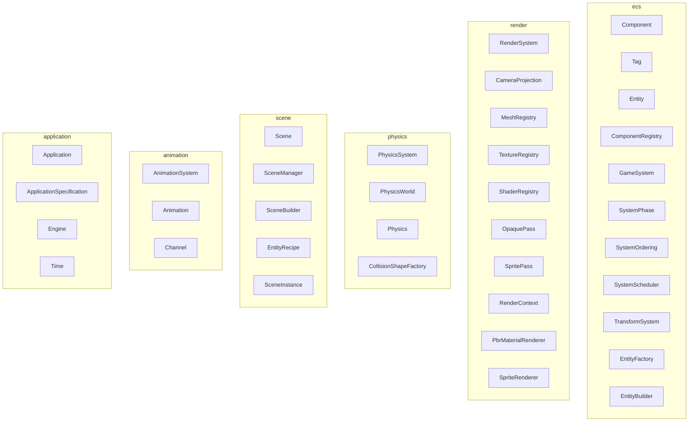

# Neon Racer

A 3D racing game built on a custom Java game engine. The engine provides an Entity-Component-System (ECS) architecture, PBR rendering, physics simulation, skeletal animation, scene management, and a 2D sprite overlay — all powered by LWJGL 3 and OpenGL.

## Build & Run

```bash
./gradlew build              # Build both modules
./gradlew :app:run           # Run the game (requires display/GPU)
./gradlew :app:shadowJar     # Create fat JAR at app/build/libs/neon-racer-<version>.jar
./gradlew :core:test         # Run core unit tests (JUnit 5)
./gradlew :app:test          # Run app unit tests
./gradlew test               # Run all tests
```

JVM flag `--enable-native-access=ALL-UNNAMED` is required at runtime (configured in build.gradle.kts).

## Engine TODO

* save/load feature
* UI/HUD enhancements
* audio

## Engine Architecture

### Core Systems



### Rendering Pipeline



Per frame:



### Scene System



### Engine Lifecycle



### System Execution Order



| Phase | Systems | Managed By |
|-------|---------|-----------|
| INPUT | *(reserved for future input system)* | Engine |
| LOGIC | TweenSystem, AnimationSystem, TransformSystem, *scene systems* | Engine + Scene |
| PHYSICS | PhysicsSystem | Engine |
| RENDER | RenderSystem | Engine |

Engine systems are registered as permanent systems by `Engine.create()`. Scene-provided systems (user-defined) run in LOGIC phase alongside engine systems, sorted by `SystemOrdering`.

### System Ownership



### Configuration API



Usage:

```java
Application.run(ApplicationSpecification.builder()
    .windowSpec(new WindowSpecification("Neon Racer", 1920, 1080))
    .physicsConfig(PhysicsWorldConfig.defaults())  // optional
    .initialScene(myScene)
    .build()
);
```

### Package Organization



### ECS (Entity-Component-System)

ECS is a data-oriented architecture pattern where game objects are decomposed into:

- **Entities** — plain integer IDs (`Entity.create(registry)`). Not objects — just unique numbers that index into component storage.
- **Components** — data-only classes implementing `Component` (Transform, Mesh, PbrMaterial, PointLight, etc.). Hold state but no logic.
- **Tags** — empty components implementing `Tag` (OpaqueLayer, SpriteLayer, PlayerTag). Used purely for filtering in queries.
- **Systems** — logic classes implementing `GameSystem` that operate on entities via queries each frame.

This separation means data is stored contiguously by type (cache-friendly), systems are decoupled from each other, and new behaviors can be added by composing existing components rather than inheriting from base classes.

Query API:
```java
// Zero-alloc iteration with typed components
registry.forEach(Transform.class, Velocity.class, (entityId, transform, vel) -> {
    transform.getPosition().add(vel.dx() * delta, vel.dy() * delta, 0);
});

// Singleton access
Camera camera = registry.getSingleton(Camera.class).orElse(null);

// Name-based lookup
int player = registry.getEntityByName("player");
```

### Component Validation

Scene instantiation validates component dependencies:

| Component | Requires |
|-----------|----------|
| Mesh | Transform |
| PhysicsBody | Transform |
| PointLight | Transform |
| SpriteMaterial | Mesh |
| PbrMaterial | Mesh |
| Skeleton | Mesh |

Entities violating these rules are skipped with a clear error message.

## Tech Stack

- Java 21+, Lombok for boilerplate reduction
- LWJGL 3 (OpenGL, GLFW, STB)
- JOML (vectors, matrices, quaternions)
- JBullet (physics)
- fastutil (primitive collections)
