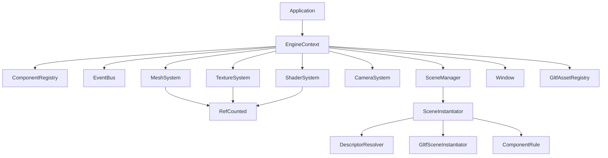
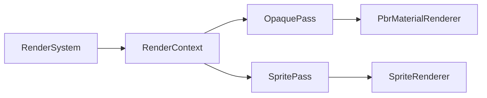
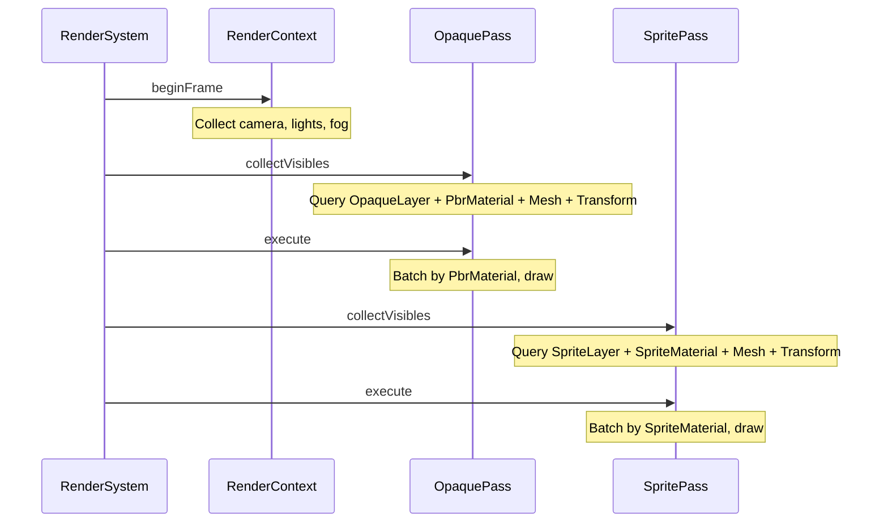
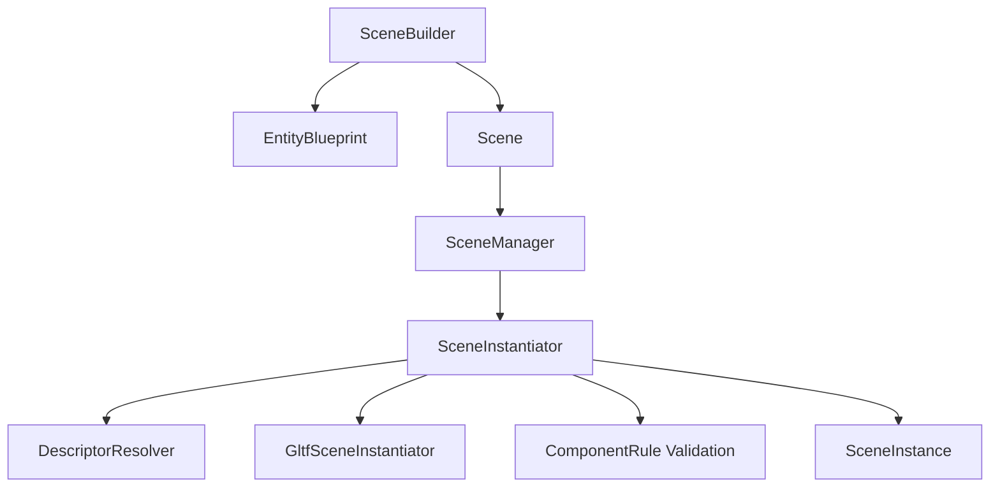
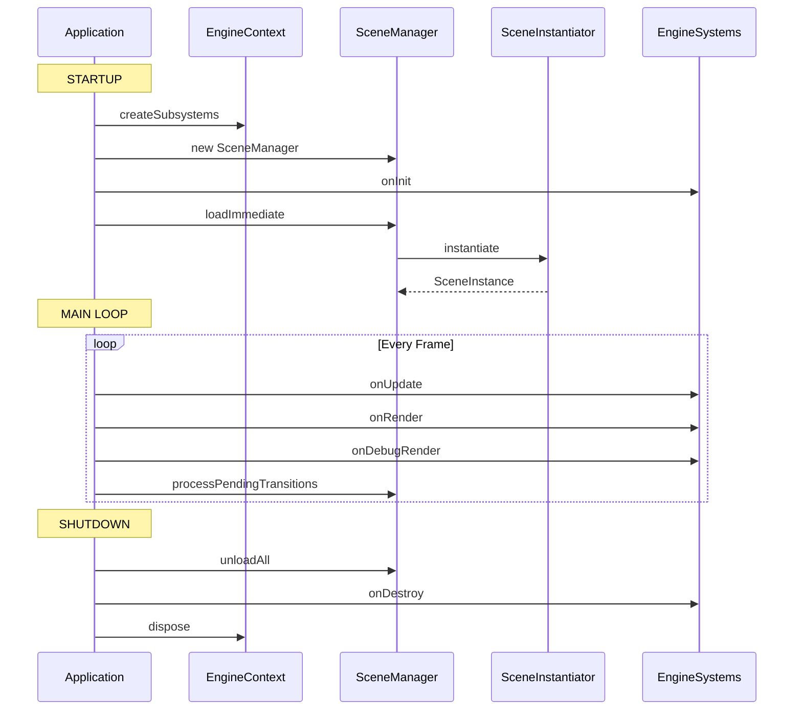
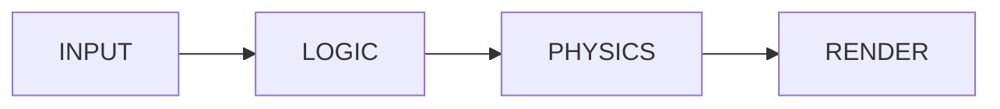

# Neon Racer

A 3D game engine and racing game built from scratch in Java with LWJGL 3/OpenGL.

## Build & Run

```bash
./gradlew build              # Build both modules
./gradlew :app:run           # Run the game (requires display/GPU)
./gradlew :app:shadowJar     # Create fat JAR
./gradlew :core:test         # Run core unit tests
./gradlew test               # Run all tests
```

## Project Structure

```
neon-racer/
  core/   — Reusable game engine library (org.chapzlock.core)
  app/    — The neon-racer game (org.chapzlock.app)
```

## Engine Architecture

### Core Systems



### Rendering Pipeline



Per frame:



### Scene System



### Engine Lifecycle



### System Execution Order



| Phase | Systems |
|-------|---------|
| INPUT | InputMap.frameReset |
| LOGIC | TransformSystem, AnimationSystem, game systems |
| PHYSICS | PhysicsSystem |
| RENDER | RenderSystem |

### ECS

- **Entities** are plain integer IDs (`Entity.create(registry)`)
- **Components** implement `Component` — data holders (Transform, Mesh, PbrMaterial, PointLight, etc.)
- **Tags** implement `Tag` — empty markers for query filtering (OpaqueLayer, SpriteLayer, PlayerTag)
- **Systems** implement `GameSystem` — logic that operates on entities via queries

Query API:
```java
// Zero-alloc iteration with typed components
registry.forEach(Transform.class, Velocity.class, (entityId, transform, vel) -> {
    transform.getPosition().add(vel.dx() * delta, vel.dy() * delta, 0);
});

// Singleton access
Camera camera = registry.getSingleton(Camera.class).orElse(null);

// Name-based lookup
int player = registry.getEntityByName("player");
```

### Component Validation

Scene instantiation validates component dependencies:

| Component | Requires |
|-----------|----------|
| Mesh | Transform |
| PhysicsBody | Transform |
| PointLight | Transform |
| SpriteMaterial | Mesh |
| PbrMaterial | Mesh |
| Skeleton | Mesh |

Entities violating these rules are skipped with a clear error message.

## Tech Stack

- Java 21+, Lombok
- LWJGL 3 (OpenGL, GLFW, STB)
- JOML (vectors, matrices, quaternions)
- JBullet (physics)
- fastutil (primitive collections)
