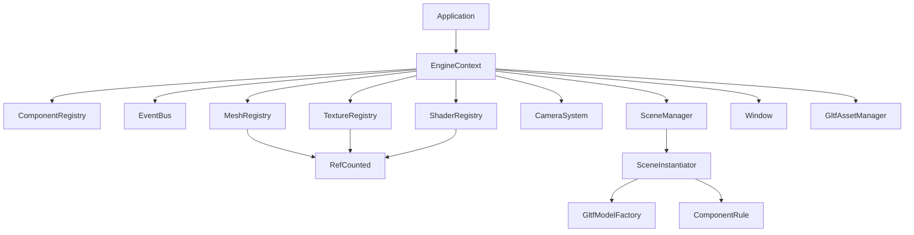
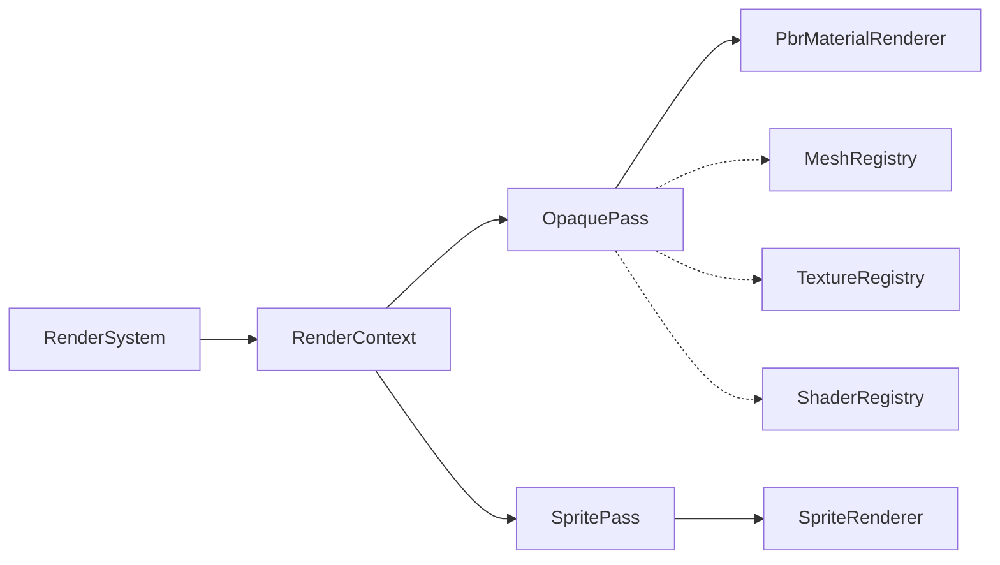
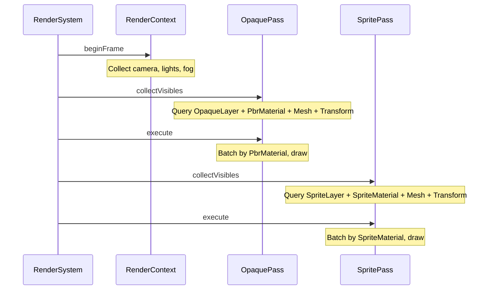
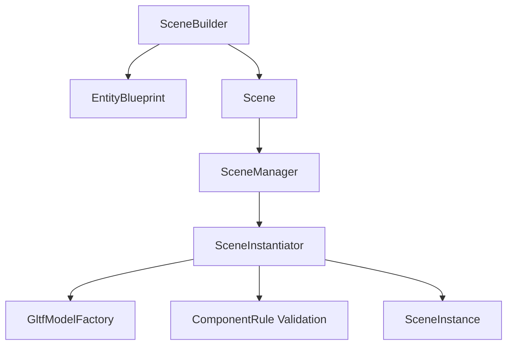
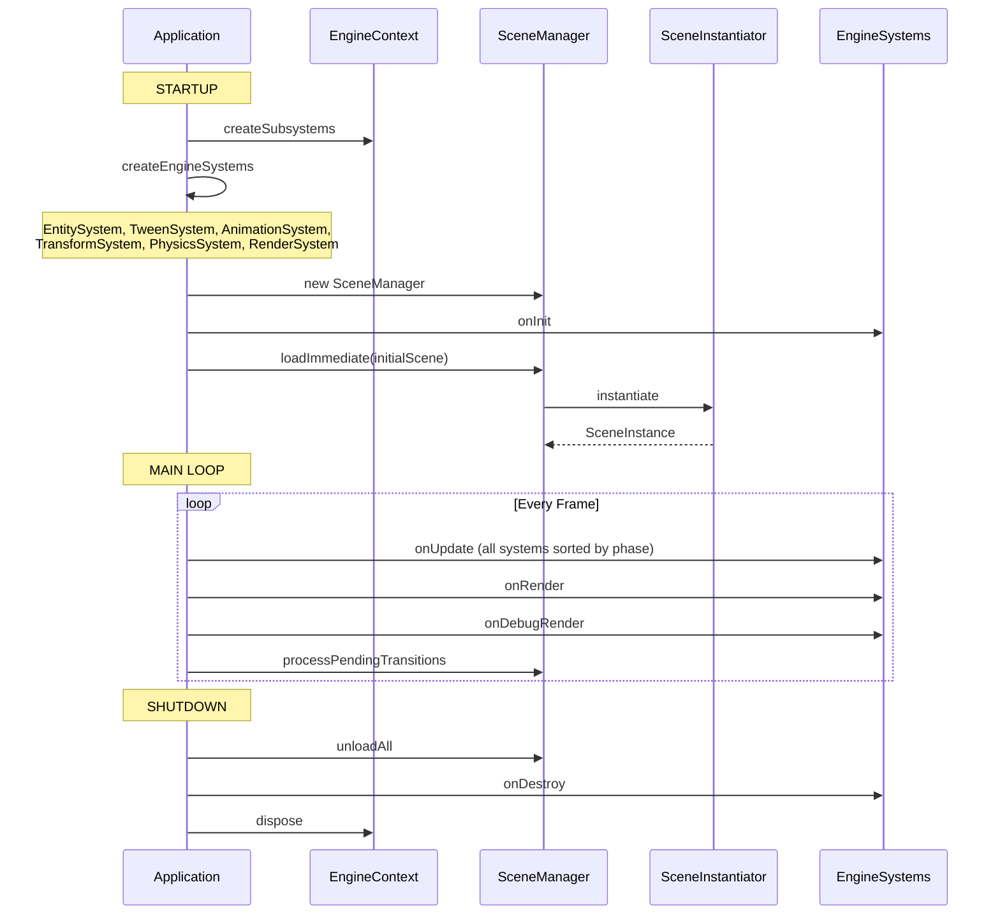
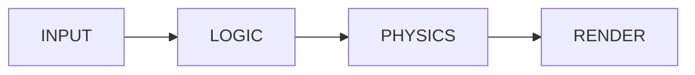
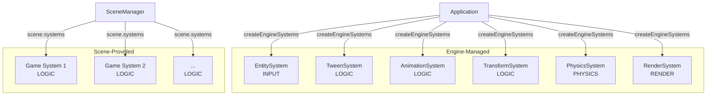
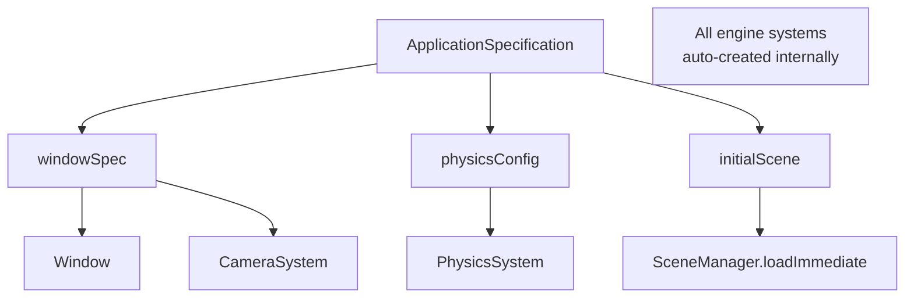
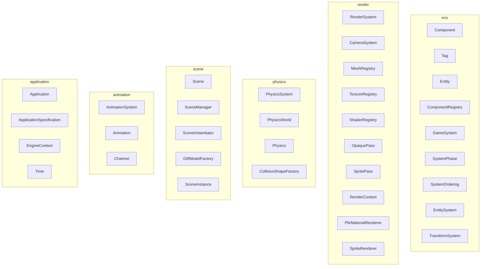

## Engine TODO

* particle effects
* font rendering
* save/load feature
* UI/HUD enhancements

## Engine Architecture

### Core Systems



### Rendering Pipeline



Per frame:



### Scene System



### Engine Lifecycle



### System Execution Order



| Phase | Systems | Managed By |
|-------|---------|-----------|
| INPUT | EntitySystem | Engine |
| LOGIC | TweenSystem, AnimationSystem, TransformSystem, *scene systems* | Engine + Scene |
| PHYSICS | PhysicsSystem | Engine |
| RENDER | RenderSystem | Engine |

Engine systems are created internally by `Application.createEngineSystems()`. Scene-provided systems (user-defined) run in LOGIC phase alongside engine systems, sorted by `SystemOrdering`.

### System Ownership



### Configuration API



Usage:

```java
Application.create(ApplicationSpecification.builder()
    .windowSpec(new WindowSpecification("Neon Racer", 1920, 1080))
    .physicsConfig(PhysicsConfig.defaults())  // optional
    .initialScene(myScene)
    .build()
).run();
```

### Package Organization



### ECS

- **Entities** are plain integer IDs (`Entity.create(registry)`)
- **Components** implement `Component` — data holders (Transform, Mesh, PbrMaterial, PointLight, etc.)
- **Tags** implement `Tag` — empty markers for query filtering (OpaqueLayer, SpriteLayer, PlayerTag)
- **Systems** implement `GameSystem` — logic that operates on entities via queries

Query API:
```java
// Zero-alloc iteration with typed components
registry.forEach(Transform.class, Velocity.class, (entityId, transform, vel) -> {
    transform.getPosition().add(vel.dx() * delta, vel.dy() * delta, 0);
});

// Singleton access
Camera camera = registry.getSingleton(Camera.class).orElse(null);

// Name-based lookup
int player = registry.getEntityByName("player");
```

### Component Validation

Scene instantiation validates component dependencies:

| Component | Requires |
|-----------|----------|
| Mesh | Transform |
| PhysicsBody | Transform |
| PointLight | Transform |
| SpriteMaterial | Mesh |
| PbrMaterial | Mesh |
| Skeleton | Mesh |

Entities violating these rules are skipped with a clear error message.

## Tech Stack

- Java 21+, Lombok
- LWJGL 3 (OpenGL, GLFW, STB)
- JOML (vectors, matrices, quaternions)
- JBullet (physics)
- fastutil (primitive collections)
